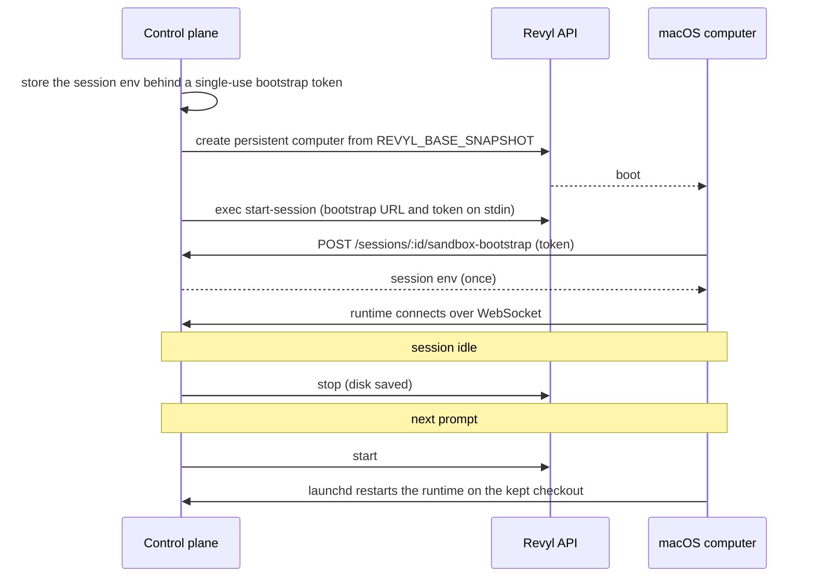

# Revyl Sandbox Provider

With `SANDBOX_PROVIDER=revyl`, each session runs in its own persistent macOS computer on
[Revyl](https://docs.revyl.com). An idle session's computer is stopped, which saves its whole disk,
and the next prompt starts it again from that save, possibly on another Mac. New sessions are
created from a base snapshot that already carries the runtime.

Persistent computers are a preview; the API key's organization must have them enabled.

## How it works



- **Launch.** The control plane creates a persistent computer from the base snapshot, waits until it
  is active, and runs one command in it through the exec API. That command receives only the
  bootstrap URL and token, on stdin, which Revyl does not record. The guest launcher redeems the
  token over HTTPS, as on EC2, so the session environment never passes through Revyl.
- **Idle and resume.** A preserve-stop stops the computer and waits until its disk is saved. Resume
  starts it; a LaunchDaemon restarts the runtime from the kept environment, which resumes without
  re-running `setup.sh`. A computer whose save can no longer start is replaced by a fresh spawn.
- **Archive.** Archiving deletes the computer and its saved disk.
- **Lifetime.** Each create or start asks for the session lifetime, clamped to Revyl's 1 minute to
  24 hours, and reports Revyl's expiry to the control plane.

### Not supported (yet)

- Preview URLs, code-server, the web terminal and VNC: nothing outside the computer can reach its
  ports.
- Prebuilt repository images; every session clones and runs `setup.sh` on its first boot.
- Codex sessions: its process containment is Linux-only.
- Docker inside the sandbox.

## Setup

The provider runs on the Node-hosted control plane only (Docker Compose or the AWS bring-up),
because it uses the session bootstrap store. `WORKER_URL` must be `https://` and reachable from the
internet.

1. Build the base snapshot with the [revyl CLI](https://docs.revyl.com) signed in to your
   organization:

   ```bash
   packages/revyl-infra/build-base-snapshot.sh \
     https://github.com/<you>/background-agents.git <branch> oi-base-1
   ```

2. Set, in `.env`:

   | Variable              | Required | Meaning                                              |
   | --------------------- | -------- | ---------------------------------------------------- |
   | `SANDBOX_PROVIDER`    | yes      | `revyl`                                              |
   | `REVYL_API_KEY`       | yes      | API key of an organization with persistent computers |
   | `REVYL_BASE_SNAPSHOT` | yes      | Snapshot name or ID from step 1                      |
   | `REVYL_API_URL`       | no       | API base URL; defaults to `https://backend.revyl.ai` |

3. Add the model keys your sessions use as global secrets in Settings › Secrets.

Rebuild the snapshot after `packages/sandbox-runtime` or `packages/revyl-infra` change and update
`REVYL_BASE_SNAPSHOT`. Running sessions keep the disk they started from.

## Connect timeout

A start that restores a save from Revyl's off-host store can take several minutes, longer than the
control plane's original 240 s connect watchdog. This fork raises that bound to 420 s for every
provider.
